# インストールと起動

## デスクトップ版（スタンドアロン）

[Releases](https://github.com/tatsunidas/GRAPHY-Next/releases) から OS 別のインストーラを
入手して実行するだけです。バックエンド（H2 ＋ ファイルシステム）・Java ランタイム・ffmpeg を
すべて同梱しているため、追加のインストールは要りません。

| OS | 成果物 | 導入方法 |
|---|---|---|
| Windows | `GRAPHY-Next.Setup.<ver>.exe`（NSIS） | 実行してインストール。初回は SmartScreen の警告が出る（下記） |
| macOS | `GRAPHY-Next-<ver>-arm64.dmg` | マウントして Applications へ。初回は「開いていません」と出る（下記） |
| Linux（Ubuntu / Debian） | `graphy-next-desktop_<ver>_amd64.deb` | `sudo apt install ./graphy-next-desktop_<ver>_amd64.deb`（推奨） |
| Linux（その他） | `GRAPHY-Next-<ver>.AppImage` | `chmod +x` して実行。libfuse2 が要る。Ubuntu 24.04 などでは起動しないことがある（下記） |

GRAPHY-Next は、Microsoft・Apple の有料の署名をまだ受けていません。そのため Windows と macOS では、
初回だけ次の警告が出ます。手順どおりに進めれば開けます。画面は、配布物をブラウザで落とした状態から
リリースのたびに自動で撮ったものです。

### Windows: SmartScreen の警告

1. インストーラを開くと「Windows によって PC が保護されました」と出ます。**詳細情報**（More info）を押します。

    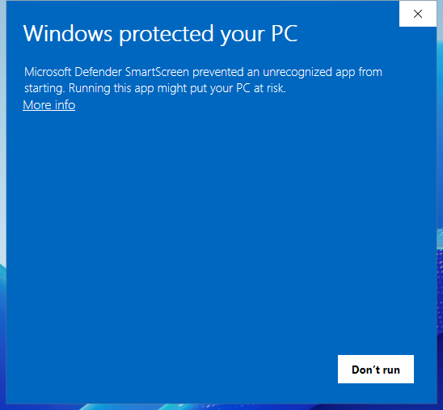{ width="480" }

2. **実行**（Run anyway）を押します。

    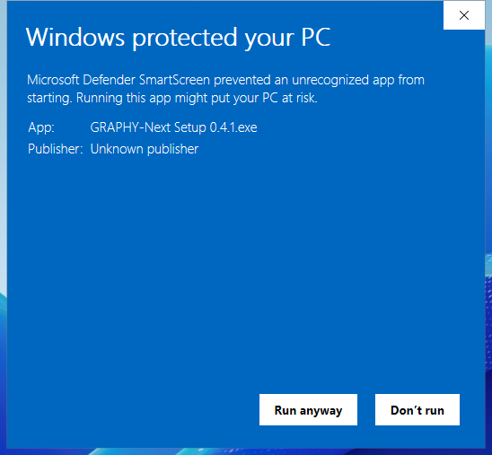{ width="480" }

3. インストーラが始まります。インストールの範囲（自分だけ／すべてのユーザー）を選んで **次へ**（Next）を押します。

    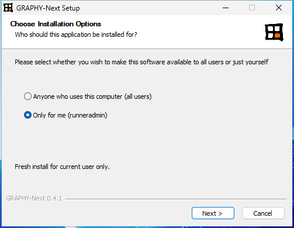{ width="480" }

4. インストール先を確かめて **インストール**（Install）を押します。

    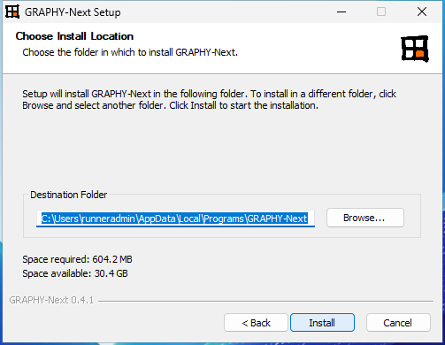{ width="480" }

5. **完了**（Finish）を押すと GRAPHY-Next が起動します。

    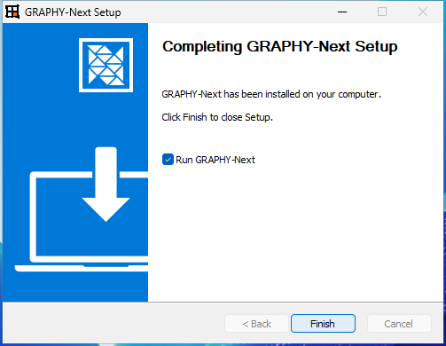{ width="480" }

    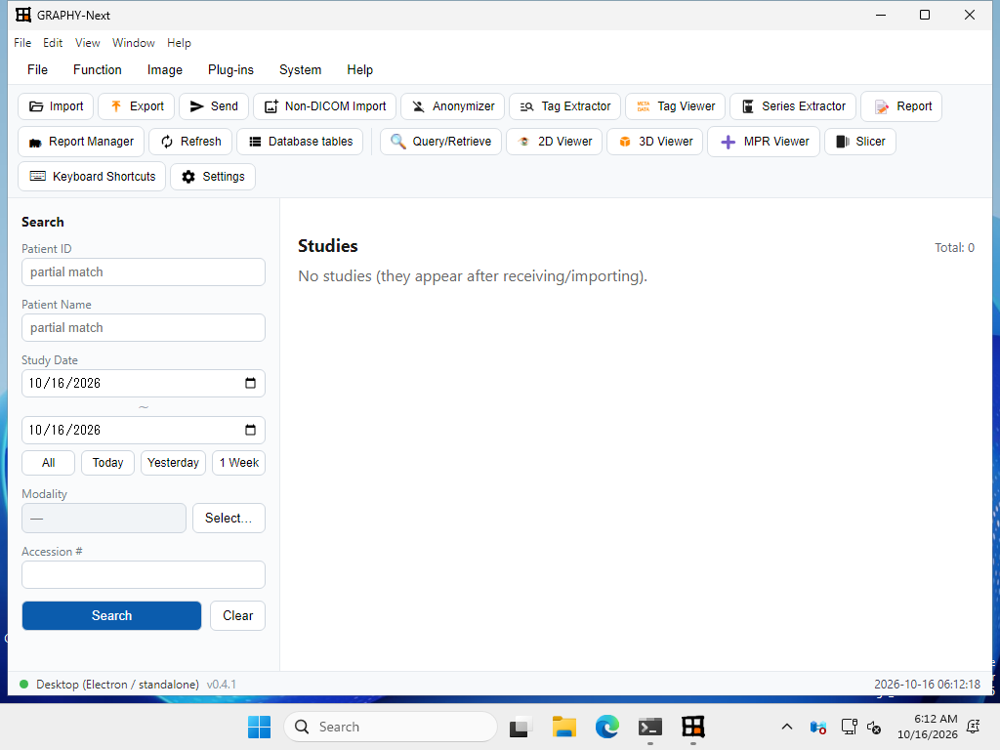{ width="640" }

!!! note "画面の言語"
    画面は英語版の Windows で撮っています。日本語版では括弧の外の表記になります。

### macOS: 「開いていません」の警告

1. dmg を開き、GRAPHY-Next を Applications へドラッグします。

    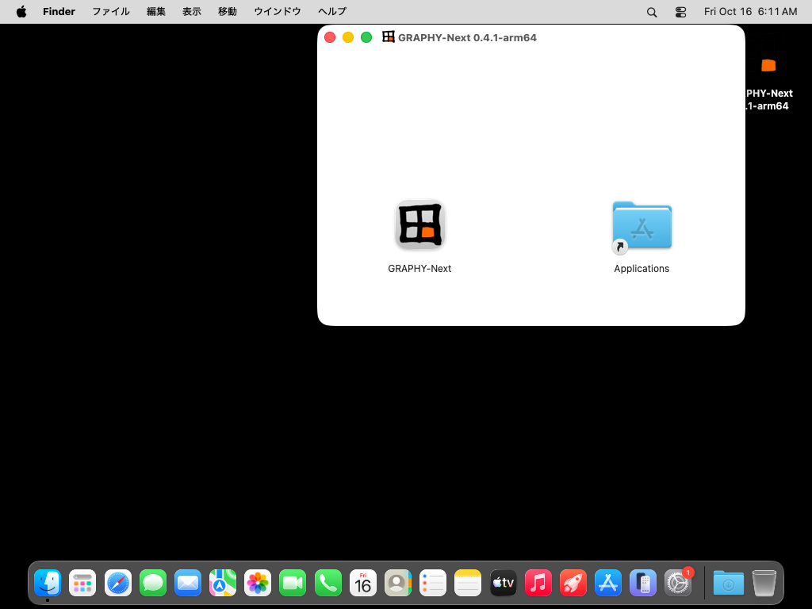{ width="560" }

2. Applications から開くと「“GRAPHY-Next”は開いていません」と出ます。**完了** を押して閉じます
   （**ゴミ箱に入れる** は押さない）。

    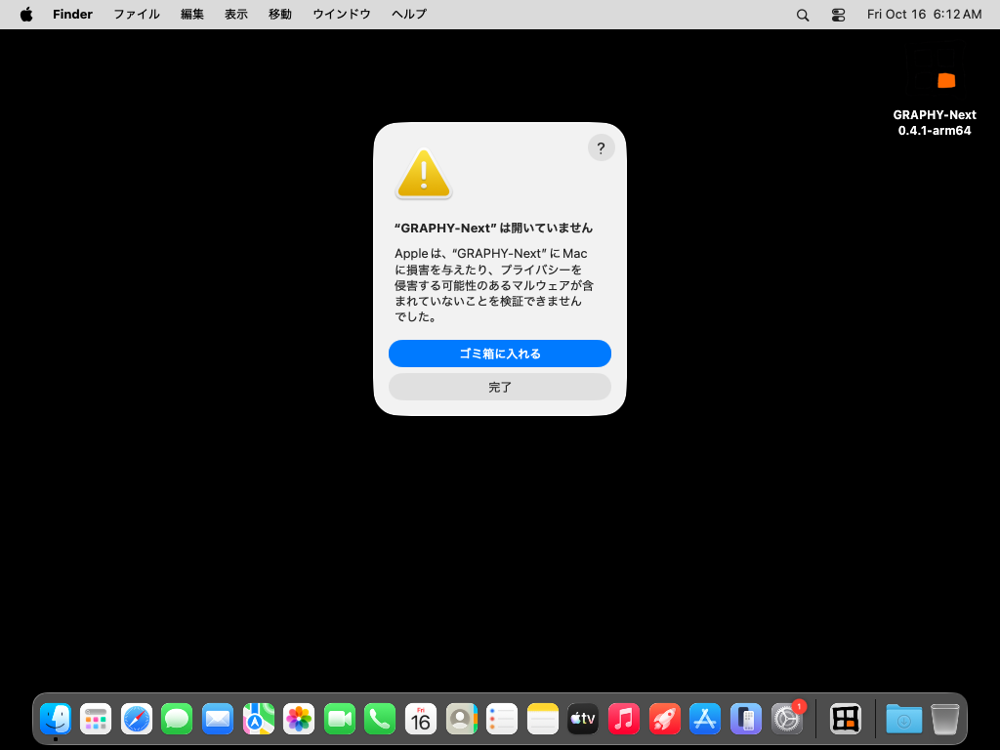{ width="560" }

3. **システム設定 ＞ プライバシーとセキュリティ** を開き、一番下の「セキュリティ」にある
   **このまま開く** を押します。

    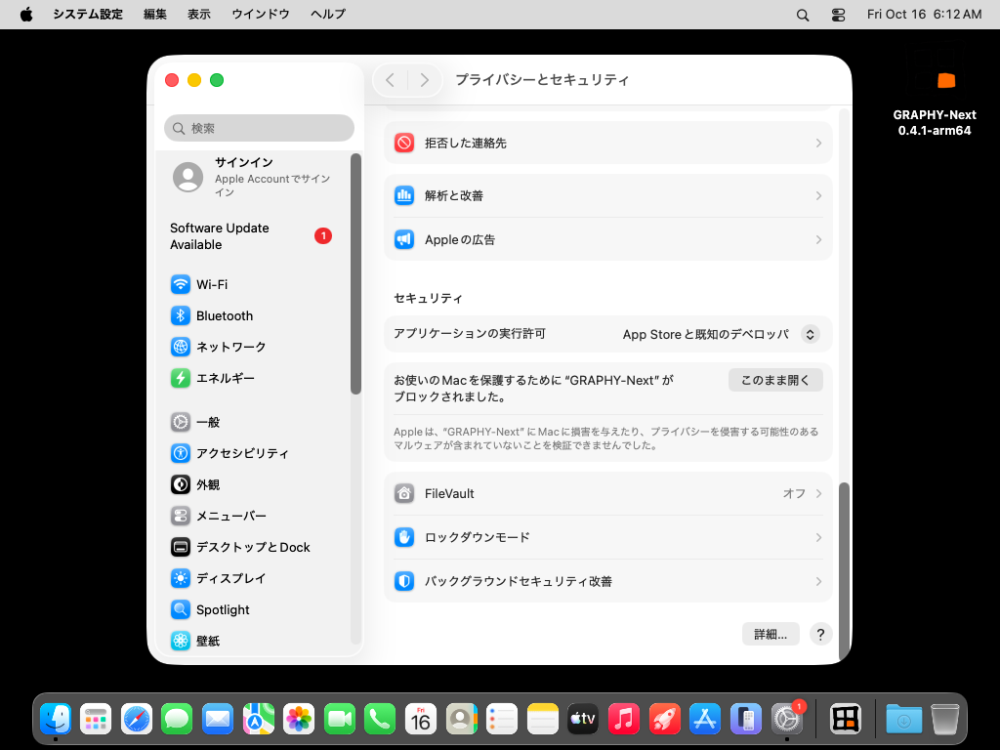{ width="560" }

4. 確認が出たら、もう一度 **このまま開く** を押します。

    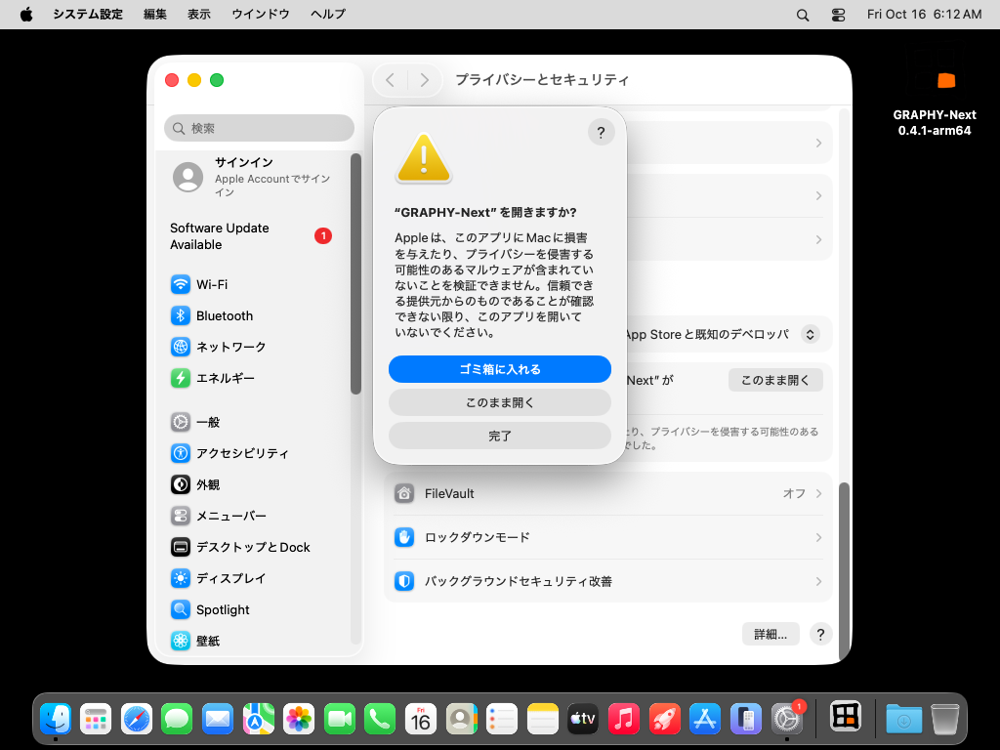{ width="560" }

5. Mac の管理者のユーザ名とパスワードを入れて **OK** を押します（Apple の手順では、これで開けるようになります）。
   次回からは普通に開けます。

    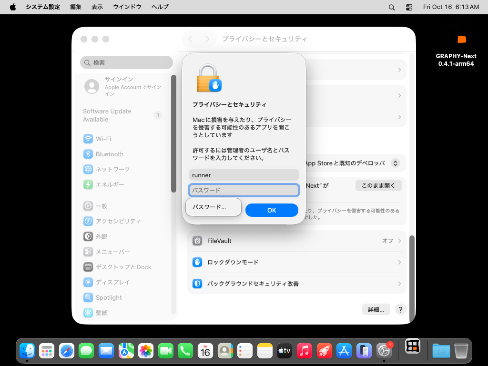{ width="560" }

### Linux

Ubuntu / Debian 系は `.deb` を使ってください。apt が必要なライブラリをそろえ、Ubuntu 24.04 以降で
Chromium の sandbox が動くための設定（AppArmor のプロファイル）も入れます。

```bash
sudo apt install ./graphy-next-desktop_<ver>_amd64.deb
graphy-next-desktop    # アプリの一覧からも起動できます
```

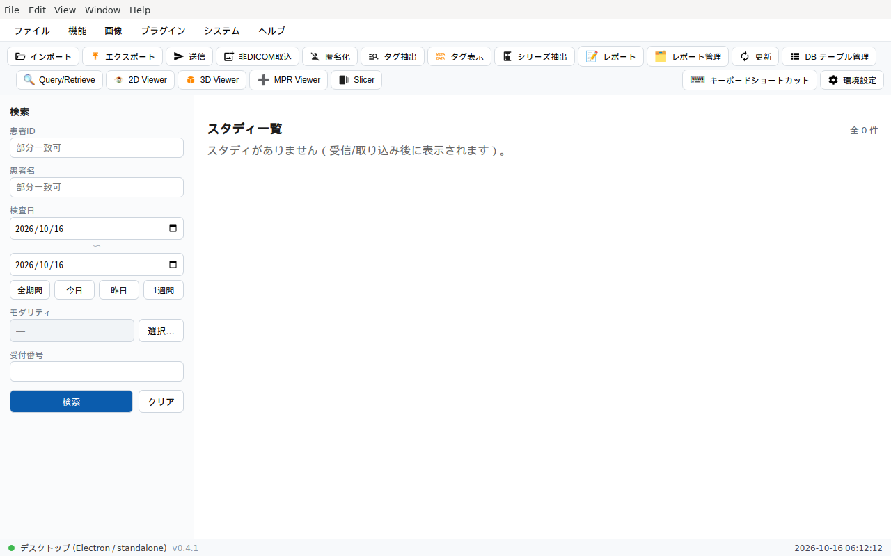{ width="640" }

!!! warning "AppImage について"
    AppImage は、そのまま実行すると Ubuntu 22.04 以降で次の 2 か所で止まることがあります。

    - `dlopen(): error loading libfuse.so.2` … `sudo apt install libfuse2t64`（22.04 は `libfuse2`）で解消します。
    - `The SUID sandbox helper binary was found, but is not configured correctly` … Ubuntu 24.04 などの
      AppArmor の制限によるものです。`.deb` を使ってください。

初回起動時に、DICOM 保管フォルダと H2 データベースを作成します。DICOM 受信（SCP）・
ローカル保管・全ビューア機能がオフラインで動作します。

### 保存データの場所

保存データ（DICOM 保管庫・H2 データベース・plugins）は、インストール先ではなく
**OS 標準のユーザーデータ領域**に作られます。アンインストールで巻き添えに消えません。

| OS | 保存先 |
|---|---|
| Windows | `%APPDATA%\GRAPHY-Next` |
| macOS | `~/Library/Application Support/GRAPHY-Next` |
| Linux | `~/.config/GRAPHY-Next` |

### 更新の確認

起動時に GitHub Releases の最新版を確認し、新しいバージョンがあればダイアログでお知らせします
（**Help ＞ 更新を確認** から手動確認も可能）。入れ替えは、新しいインストーラを実行しての
**上書きアップグレード**で行います（データは保持されます）。

「このバージョンをスキップ」を選ぶと、その版は起動時に再通知しません。

### アンインストール

アプリ内の **Help ＞ アンインストール** に、OS 別の手順を表示します。いずれも
**保存データは既定で保持**され、削除するかどうかは確認のうえ選べます。

| OS | 手順 |
|---|---|
| Windows | 設定 ＞ アプリ ＞ GRAPHY-Next ＞ アンインストール。ウィザードが保存データも削除するか確認します |
| macOS | GRAPHY-Next.app をゴミ箱へ。保存データも消すには同梱スクリプト `Contents/Resources/uninstall/uninstall-macos.command` を実行 |
| Linux | `.deb`: `sudo apt remove graphy-next-desktop`。AppImage: `.AppImage` を削除。保存データ / デスクトップ統合も消すには同梱スクリプト `resources/uninstall/uninstall-linux.sh` を実行 |

## Web 版（外部 PACS 連携）

Web 版は、UI を同梱した jar を `web` プロファイルで起動し、外部 PACS（dcm4chee）に
**DICOMweb（QIDO-RS / WADO-RS）** で接続する BFF です。GRAPHY 自身は画像を保管せず、
PACS 側のスタディを参照表示します。

**前提**: JDK 21 ／ Docker（dcm4chee 用）。jar は Releases の `graphy-next-backend.jar`。

### 1. PACS（dcm4chee-arc）を起動する

```bash
docker compose -f deploy/dcm4chee/docker-compose.yml up -d
```

初回は WildFly の初期化に数分かかります。管理 UI は
`http://localhost:8080/dcm4chee-arc/ui2/`、DICOMweb のベース URL は
`http://localhost:8080/dcm4chee-arc/aets/DCM4CHEE/rs` です。

### 2. GRAPHY-Next（web）を起動する

dcm4chee が 8080 を使うため、GRAPHY 側は別ポート（例: 8090）で起動し、接続先を指定します。

```bash
java -jar graphy-next-backend.jar \
  --spring.profiles.active=web \
  --server.port=8090 \
  --graphy.dicom.dicomweb.base-url=http://localhost:8080/dcm4chee-arc/aets/DCM4CHEE/rs
```

### 3. ブラウザで開く

<http://localhost:8090/> にアクセスします。`GET /api/status` の `mode` が `web` になっていれば
Web モードで動作しています。

!!! tip "接続先を恒久設定にする"
    毎回コマンドラインで渡す代わりに、`application-web.yml` の
    `graphy.dicom.dicomweb.base-url`（必要なら `bearer-token`）に記載できます。

## 試すだけなら

インストールせずに Web 版の画面を触れるライブデモがあります（ログインが必要です）。
<https://graphy.vis-ionary.com/demo> をご覧ください。
