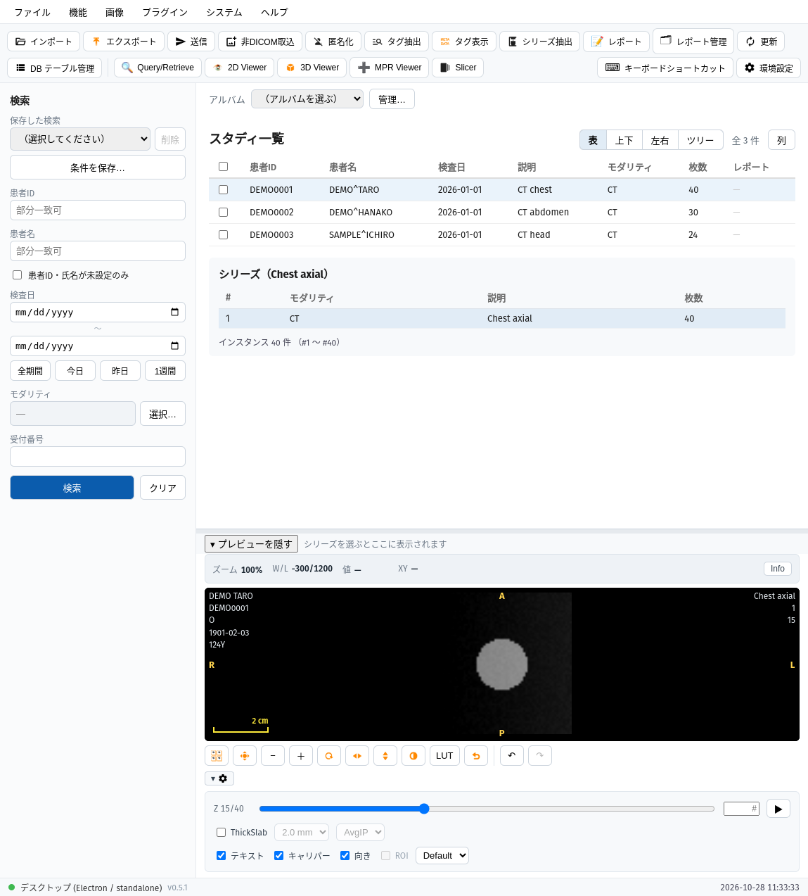
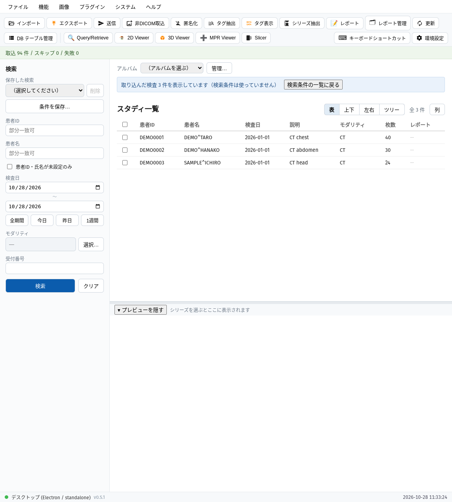
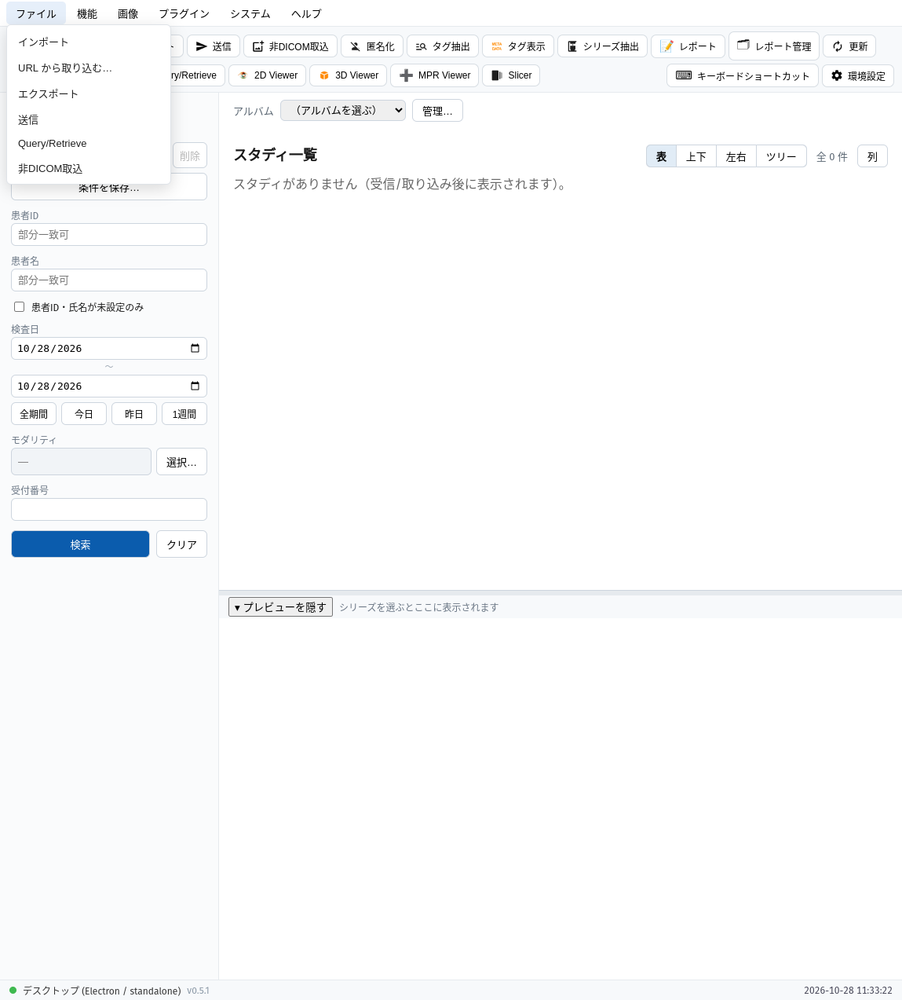
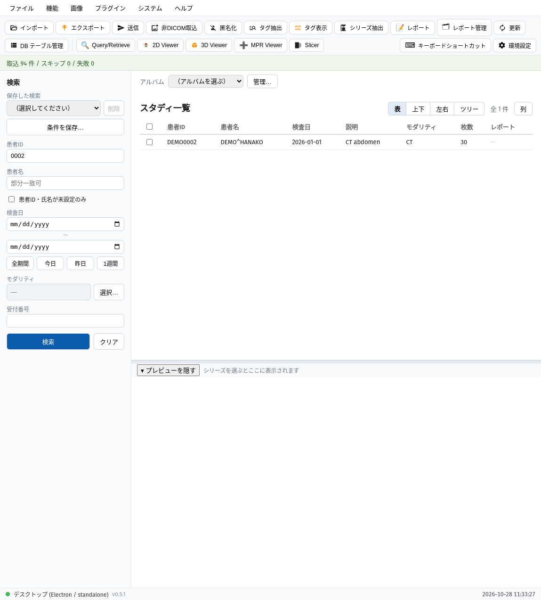
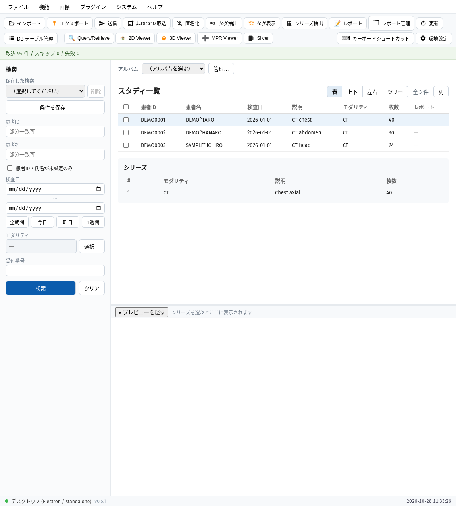
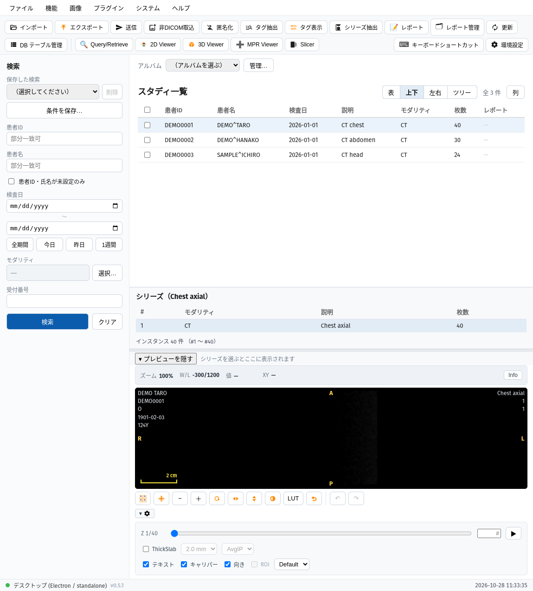
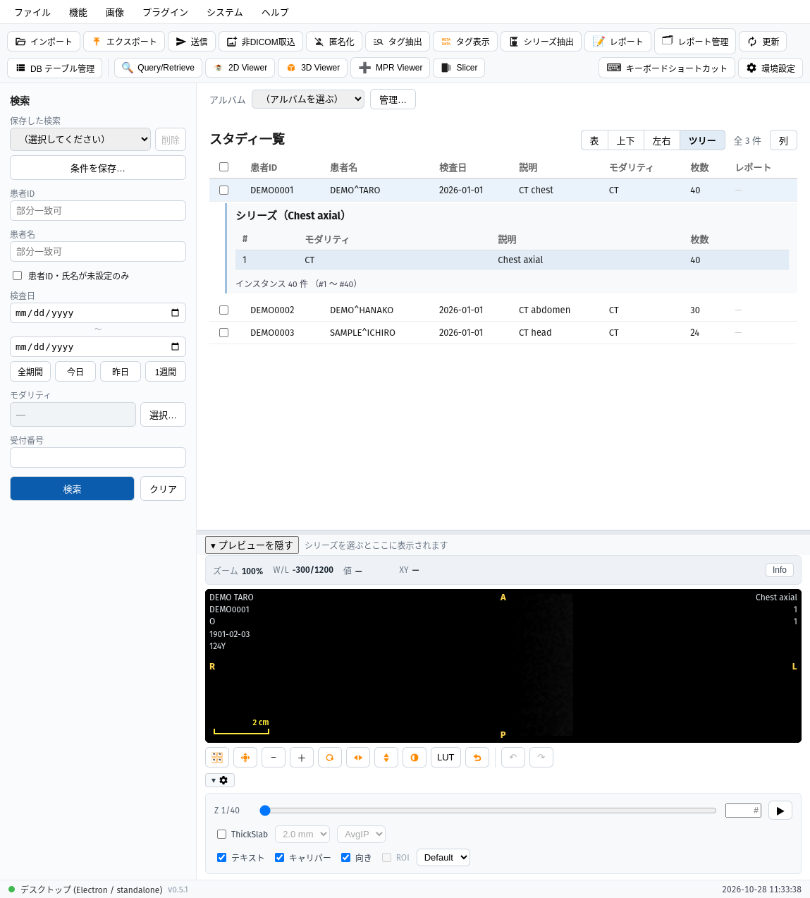

# データベースウィンドウ

アプリを起動して最初に開く画面です。取り込んだ検査（スタディ）を探し、シリーズを選んで確認し、各ビューアへ進む出発点になります。

!!! info "画面の文言の書き方"
    このマニュアルでは、画面に出る文言（メニュー名・ボタン名・項目名）を太字で書きます。例: **インポート**{.ui}。

!!! note "写真について"
    画面写真は、架空の患者名・ID の合成 CT をデスクトップ版（Linux）で撮ったものです。Windows・macOS では文字の見た目が少し違うことがあります。

## 画面の構成

上から順に次の部品が並びます。

- メニューバー: **ファイル**{.ui}・**機能**{.ui}・**画像**{.ui}・**プラグイン**{.ui}・**システム**{.ui}・**ヘルプ**{.ui}
- ツールバー: よく使う機能のボタン。右端に **キーボードショートカット**{.ui} と **環境設定**{.ui}
- 左の検索パネル（**検索**{.ui}）
- 右上: **アルバム**{.ui} の選択と、**スタディ一覧**{.ui}（検査の表）。選んだ検査のシリーズは表の下に出ます
- 下: プレビュー（選んだシリーズの画像）。**プレビューを隠す**{.ui} で畳めます
- 一番下のステータスバー: 動作モード（デスクトップ版は「Electron / standalone」）・版・時刻

## 検査を取り込む

1. メニューの **ファイル**{.ui} を開き、**インポート**{.ui} を選びます（ツールバーの **インポート**{.ui} ボタンでも同じです）。
2. フォルダ選択の画面が出るので、DICOM ファイルが入ったフォルダを選びます。サブフォルダの中のファイルも取り込まれます。
3. 取り込みが終わると、画面の上部に「取込 94 件 / スキップ 0 / 失敗 0」のように結果が出ます（数字はファイル（画像）の数です）。
4. 取り込んだ検査は、検索条件を使わずにそのまま **スタディ一覧**{.ui} に出ます。そのとき「取り込んだ検査 3 件を表示しています（検索条件は使っていません）」と表示されます。

**検索条件の一覧に戻る**{.ui} を押すと、検索パネルの条件で探す一覧に戻ります。このとき **検査日**{.ui} の既定は「今日」なので、今日の日付ではない検査は一覧に出ません（次の節を参照）。

メニューの **ファイル**{.ui} には、ほかにも次の項目があります。

- **URL から取り込む…**{.ui}
- **エクスポート**{.ui}
- **送信**{.ui}
- **Query/Retrieve**{.ui}（ほかの DICOM 機器からの取得。[DICOM 通信](dicom-network.md) を参照）
- **非DICOM取込**{.ui}

## 検査を探す

左の検索パネルに条件を入れて **検索**{.ui} を押します。**クリア**{.ui} で条件を空に戻します。

| 項目 | 入れ方 |
|---|---|
| **患者ID**{.ui} | 一部の文字で探せます（例: 「0002」で、その文字を含む患者 ID の検査に絞れます）。 |
| **患者名**{.ui} | 一部の文字で探せます。 |
| **患者ID・氏名が未設定のみ**{.ui} | チェックすると、患者 ID・氏名が未設定の検査だけを探します。 |
| **検査日**{.ui} | 開始日と終了日。下のボタンで **全期間**{.ui}・**今日**{.ui}・**昨日**{.ui}・**1週間**{.ui} をすぐ入れられます。 |
| **モダリティ**{.ui} | **選択…**{.ui} から選びます。 |
| **受付番号**{.ui} | アクセッション番号です。 |

!!! warning "検査日の既定は「今日」です"
    アプリを起動した直後は **検査日**{.ui} が今日の日付になっています。過去の検査を探すときは **全期間**{.ui} を押してから **検索**{.ui} を押してください。取り込んだ検査が一覧に出ないときは、まずここを確かめます。

条件を何も指定せずに **検索**{.ui} を押すと、「検索条件が指定されていません。多数のスタディが返る可能性があります。続行しますか？」という確認が出ます。続行すると、検査日の範囲に含まれるすべての検査が出ます。

保存した条件を呼び出す **保存した検索**{.ui} と、今の条件を保存する **条件を保存…**{.ui} も検索パネルにあります。

## 一覧と選択

**スタディ一覧**{.ui} には、患者 ID・患者名・検査日・説明・モダリティ・枚数・レポートの有無が並びます。見出しの右の **列**{.ui} を押すと「一覧の列」の画面が開き、DICOM の辞書（キーワードまたはタグ）から探して、一覧に列を足せます。**シーケンス・プライベートを指定…**{.ui} で、シーケンスやプライベートタグも指定できます。足した列の値は、表示中のスタディのシリーズの代表 1 枚から読み取ります（DICOM ファイルにも索引にも書き込みません）。足した列での並べ替え・絞り込みはできません。

- 行の左のチェックは、複数の検査をまとめて選ぶためのものです（見出しのチェックで全選択）。
- 行を押すと、その検査のシリーズが表の下に出ます。シリーズの行を押すと、下のプレビューに画像が出ます。
- プレビューでは、スライダーでスライスを動かせます。

### 一覧の表示形式

一覧の見出しの右のボタンで、**表**{.ui}・**上下**{.ui}・**左右**{.ui}・**ツリー**{.ui} を切り替えられます（選んだ形式は保存されます）。

- **表**{.ui}: 検査の表の末尾にシリーズを出す従来の表示です（既定）。
- **上下**{.ui}・**左右**{.ui}: 検査の表の下（右）に、シリーズの一覧を常に見せます。
- **ツリー**{.ui}: 選んだ検査の行のすぐ下に、シリーズが子として開きます。同じ行をもう一度押すと畳みます。

**上下**{.ui}・**左右**{.ui}・**ツリー**{.ui} では、検査を選ぶと最初の画像シリーズが自動で開き、画像は下部のプレビューに出ます。

## ビューアを開く

検査（またはシリーズ）を選んでから、ツールバーのボタン、またはメニューの **画像**{.ui} から開きます。

- **2D Viewer**{.ui}: 別のウィンドウで、選んだシリーズを開きます。
- **3D Viewer**{.ui}・**MPR Viewer**{.ui}・**Slicer**{.ui}: それぞれの画面の使い方は [3D ビューア](viewer3d.md)・[MPR / Slicer / Curved MPR](reformat.md) を参照してください。

## このページに説明が無い機能

次の機能は、ツールバーとメニューにあります。説明は別のページとして追加する予定です。

**匿名化**{.ui}・**タグ抽出**{.ui}・**タグ表示**{.ui}・**シリーズ抽出**{.ui}・**レポート**{.ui}・**レポート管理**{.ui}・**更新**{.ui}・**DB テーブル管理**{.ui}

関連: [DICOM 通信](dicom-network.md) ／ [環境設定](settings.md)
